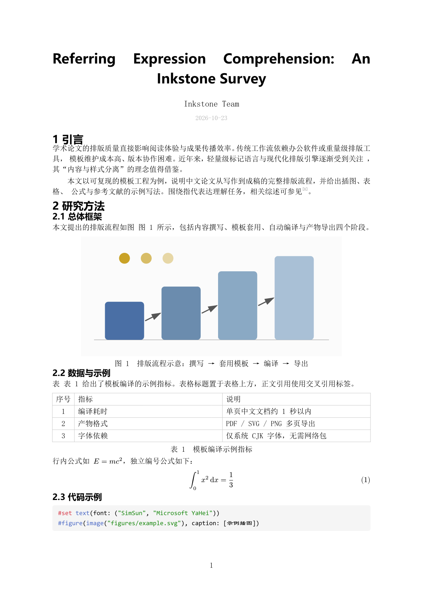

# 文房四宝 · Inkstone

一套把 **文献收集 → 排版 → 归档** 串起来的 DeepSeek Harness 插件包。四个插件取“文房四宝”意象：

**Topics**：`dsh-plugin` · `deepseek-harness` · `trilium-notes` · `zotero` · `typst` · `mcp` · `literature-review` · `typesetting` · `pipeline`



| 插件 | 行 id | 显示名 | 职责 |
|---|---|---|---|
| `trilium-paper` | `inkstone-trilium` | 纸 · Trilium Notes | ETAPI + 官方 MCP 双通道：检索、读写笔记、附件、属性、历史 |
| `zotero-ink` | `inkstone-zotero` | 墨 · Zotero 文献 | 本地 API + `.bib` 工程：检索、citekey、导出/合并/校验、PDF 全文与批注、在线补全 |
| `typst-brush` | `inkstone-typst` | 笔 · Typst 排版 | Typst CLI 编译/导出 PDF·SVG·PNG，规则化自愈，中文模板 |
| `inkstone-flow` | `inkstone-flow` | 砚 · 联合流水线 | 声明式配方引擎 + 检查点续跑 + 运行记录，串联前三者 |

- 插件包名：`dsh-inkstone`（单 bundle 四行插件）
- 仓库：[github.com/ABL312/dsh-inkstone](https://github.com/ABL312/dsh-inkstone)
- 设计文档：[docs/DESIGN.md](docs/DESIGN.md) · 实现契约：[docs/CONTRACT.md](docs/CONTRACT.md) · 更新日志：[CHANGELOG.md](CHANGELOG.md)

## 已具备的能力

### 纸 · Trilium（`trilium_*`）

`trilium_search`、`trilium_read`、`trilium_write`、`trilium_attach`、`trilium_history`；
`advancedTools: true` 时追加 `trilium_attributes`、`trilium_delete`。

- 认证走 ETAPI token（裸 `Authorization` 头）；MCP 行另用 Bearer。
- 写入只发生在显式调用；`allowWrites: false` 可整体拒绝写操作。
- Markdown 内容会转换为安全 HTML 子集再写入。

### 墨 · Zotero（`zotero_*`）

`zotero_search`、`zotero_item`、`zotero_bib`（index/export/validate/merge）、`zotero_pdf`（path/text/annotations）、
`zotero_enrich`（Crossref/OpenAlex/arXiv）；`advancedTools` + `ZOTERO_API_KEY` 时追加 `zotero_write`（Web API）。

- 读取只依赖 Zotero 本地 API（127.0.0.1:23119），无需密钥。
- `.bib` 解析器自研：嵌套花括号、引号值、`@string`、`#` 拼接、UTF-8、BBT 字段、重复 key、缺字段检查。
- PDF 文本用 `pdftotext`（自动探测 dsh-ops 内置 Poppler、Git/MSYS2、winget Poppler、PATH）。
- Zotero 原生 citation key（Zotero 7+）即可用；Better BibTeX 为可选增强。

### 笔 · Typst（`typst_*`）

`typst_build`（默认自愈）、`typst_export`（多页 SVG/PNG）、`typst_probe`；
`advancedTools` 时追加 `typst_compile_raw`、`typst_clean`。

- 二进制探测顺序：配置/`TYPST_BIN` → PATH → WinGet Links → WinGet Packages → cargo/scoop。
- 自愈白名单：未知字体族、未知引用键（编辑距离 ≤2）、缺失图片/bib/include 路径；改前备份到
  `<项目>/.inkstone/backups/`，最多 3 轮，无进展即停。
- 模板：`paper-zh`、`report-zh`、`slides-zh`（16:9）、`poster-zh`（A2 竖版），自包含、无网络包。

### 砚 · 流水线（`pipeline_*`）

`pipeline_list`、`pipeline_run`、`pipeline_status`；`advancedTools` 时追加 `pipeline_validate`。

内置配方：

| 配方 | 场景 | 步骤 |
|---|---|---|
| `paper-delivery` | 期刊/会议论文 | 文献→bib→论文模板→检查点写作→自愈编译→PNG 预览→Trilium 发布→报告 |
| `course-report` | 课程论文/实验报告 | 报告模板→检查点写作→自愈编译→预览→可选发布→报告 |
| `lit-review` | 文献综述/读书笔记 | Zotero 检索→按选中条目导出 bib→生成综述 Markdown→可选归档 Trilium→报告 |
| `slides-poster` | 幻灯片/海报 | 模板→检查点写作→编译→逐页 PNG→可选发布→报告 |

运行目录：`<项目>/.inkstone/runs/<runId>/`（`run.json`、`report.md`、产物、诊断 JSON）。

## 安装与更新

前置：DeepSeek Harness（desktop profile）、Node.js 22+；按需准备 Trilium、Zotero 7+、Typst 0.13+。

从 GitHub 安装：

```
plugin_manager install_bundle target="git+https://github.com/ABL312/dsh-inkstone.git"
```

本地开发时可以直接 link 仓库目录：

```
git clone https://github.com/ABL312/dsh-inkstone.git
plugin_manager install_bundle target="<仓库绝对路径>"
```

更新已安装版本（替换包需要先移除再安装）：

```
plugin_manager remove_bundle  target="dsh-inkstone"
plugin_manager install_bundle target="git+https://github.com/ABL312/dsh-inkstone.git"
```

> 本地 linked bundle 的代码改动需要重新安装才会被 Host 进程重新加载。Windows 上偶发
> `EPERM package.json` 属瞬时文件锁，重试一次即可。

## 凭据与本地服务

### Trilium ETAPI token（发布/检索必需）

1. Trilium → Options → ETAPI → Create new token。
2. 二选一：
   - 写入 `%USERPROFILE%\.dsh-inkstone\trilium-etapi-token.txt`（首行，推荐；**无需重启 DSH**）；或
   - 在启动 DSH 前设置环境变量 `TRILIUM_ETAPI_TOKEN`。

MCP 行（`mcp__trilium__*`）只在 DSH **启动时**能读到 `TRILIUM_ETAPI_TOKEN` 才会启用；否则使用
ETAPI 工具（能力等价）。ETAPI 与 MCP 共用同一个 token。

### Zotero 本地 API

已在本机启用：`Zotero 设置 → 高级 → 允许本机应用通信`（等价预置 `user.js` 中的
`extensions.zotero.httpServer.localAPI.enabled = true`），并已重启 Zotero。验证：

```bash
curl -s -o /dev/null -w "%{http_code}\n" "http://127.0.0.1:23119/api/users/0/items?limit=1"   # 200
```

### Typst

已由 winget 安装 0.15.1；`typst_probe` 会返回实际路径与 CJK 字体清单。

## 快速上手

在 DSH 对话里直接说：

- “把 `<项目目录>` 做成期刊论文交付，题目《…》，用 Zotero 的 `<collection>` 文献”
  → 模型应调用 `pipeline_run { recipe: "paper-delivery", inputs: {...}, projectDir }`。
- “帮我把这批文献整理成综述笔记” → `pipeline_run { recipe: "lit-review", inputs: { topic, limit } }`。
- 手工单步：`zotero_search` → `zotero_bib { action: "export" }` → `typst_build` → `trilium_write` /
  `trilium_attach`。

检查点协议：运行到 `checkpoint` 会返回 `status: "awaiting"` 与 `runId`；模型按提示写
`<run 目录>/main.typ`，然后 `pipeline_run { runId }` 继续。构建失败时修复后同样用同一 `runId`
续跑，不要新建 run。

## 配置

配置位于 bundle 的 `cordis.patch.yml` 行；可在 `cordis.patch.yml` 的用户层覆盖，或用
`plugin_manager`/Settings 调整。

| 行 | 配置项 | 默认 |
|---|---|---|
| `inkstone-trilium` | `baseUrl`/`tokenEnv`/`tokenFile`/`defaultParentNoteId`/`allowWrites`/`advancedTools`/`timeoutMs` | `http://127.0.0.1:8080`、`TRILIUM_ETAPI_TOKEN`、true、false、15000 |
| `inkstone-zotero` | `localApiUrl`/`dataDir`/`bibFiles`/`citationStyle`/`advancedTools`/`timeoutMs` | `http://127.0.0.1:23119`、`~/Zotero`、`[]`、`gb-7714-2015-numeric` |
| `inkstone-typst` | `binaryPath`/`fontPaths`/`maxHealRounds`/`timeoutMs`/`advancedTools` | null、`[]`、3、120000 |
| `inkstone-flow` | `projectDir`/`runsDir`/`recipesDir`/`defaultParentNoteId`/`publish`/`advancedTools` | null、`.inkstone/runs`、null、null、true |

环境变量：`TRILIUM_ETAPI_TOKEN`、`TRILIUM_ETAPI_URL`、`ZOTERO_API_KEY`、`ZOTERO_API_USER_ID`、
`ZOTERO_LOCAL_API_URL`、`ZOTERO_DATA_DIR`、`INKSTONE_PROJECT_DIR`、`TYPST_BIN`、`PDFTOTEXT_PATH`。

本地 secret 文件：`~/.dsh-inkstone/trilium-etapi-token.txt`、`~/.dsh-inkstone/zotero-api-key.txt`。

## 故障排查

| 现象 | 处理 |
|---|---|
| `Trilium ETAPI token is not available` | 按上文创建 token 并写入 secret 文件；无需重启 |
| `无法连接 Zotero 本地 API` | 启动 Zotero；Settings → Advanced 勾选“允许本机应用通信” |
| `typst` 找不到 | `winget install --id Typst.Typst -e`；或配置 `binaryPath`/`TYPST_BIN` |
| 编译失败但已自愈 | 看错误里的诊断 JSON 路径与“已尝试修复”；修完用同一 `runId` 续跑 |
| 发布步骤被跳过 | 未配置 token（可选步骤）；配置后新建/续跑 run 即可 |
| MCP 工具不存在 | DSH 启动时没有 `TRILIUM_ETAPI_TOKEN` 环境变量；用 ETAPI 工具即可，或带变量重启 DSH |
| `pipeline_run` 返回 awaiting | 正常检查点；按提示写文件后 `pipeline_run { runId }` |

## 开发与测试

```bash
git clone https://github.com/ABL312/dsh-inkstone.git
cd dsh-inkstone
npm test                        # = node scripts/test-all.mjs，四套测试串行
node scripts/test-trilium.mjs   # 51 passed
node scripts/test-zotero.mjs    # 49 passed（含真实 pdftotext 正/负路径）
node scripts/test-typst.mjs     # 46 passed（真实 typst 编译、4 模板、5 条自愈规则）
node scripts/test-pipeline.mjs  # 36 passed（引擎、检查点、占位符、可选步骤）
node scripts/live-check.mjs     # 环境体检（Trilium/Zotero/Typst）
```

约 10,700 行实现（lib + 插件）、3,500 行测试、900 行模板与配方。实现约束：纯 ESM、只用
`node:` 内置模块与包内相对导入，不依赖任何第三方包；工具用普通定义经 `ctx.tools.register` 注册。

## 实测状态（2026-10-23）

| 项目 | 结果 |
|---|---|
| Bundle 安装/激活 | applied，四行插件全部激活 |
| 工具注册 | 可见 `trilium_*` / `zotero_*` / `typst_*` / `pipeline_*` |
| Typst 中文 PDF | 通过（含图、表、公式、引用编号） |
| Typst SVG/PNG 多页导出 | 通过 |
| 规则自愈 | 现场 3 规则修复（字体/引用键/图片路径）+ 备份，编译成功 |
| Zotero 本地 API | 200；检索、条目/附件/批注、26 条真实 `.bib` 导出、校验、PDF 全文（pdftotext）通过 |
| 流水线 | `course-report`、`lit-review`、`paper-delivery` 真实跑通（含检查点续跑、报告） |
| Trilium ETAPI | 通过：app-info、检索、创建/追加/替换、附件上传、标签、历史/导出 |
| Trilium 发布 | 通过：流水线 publish 在真实 Trilium 创建子笔记 + PDF 附件 + `inkstone/pipeline` 标签 |
| MCP 端点 | 通过：Bearer token 初始化成功，列出 23 个官方工具（search_notes/get_note/…）；插件 MCP 行需 DSH 启动时带 `TRILIUM_ETAPI_TOKEN` 才启用 |

## 已知限制

- 模板字体链面向 Windows 中文环境（SimSun/Microsoft YaHei 等）；跨平台需追加 `fontPaths` 或字体回退映射。
- Zotero 本地 API 只读；写回依赖 Web API key，未配置时不注册 `zotero_write`。
- 扫描版 PDF 无文本层时需 OCR；`zotero_pdf` 会明确说明。
- 自愈只处理白名单内的常见错误；超出范围会返回结构化诊断交给模型/人工修复。
- 同一工程的并发构建/导出可能竞争产物；流水线内部串行执行，不涉及该问题。

---

[](https://github.com/deepseek-ai/deepseek-harness)
